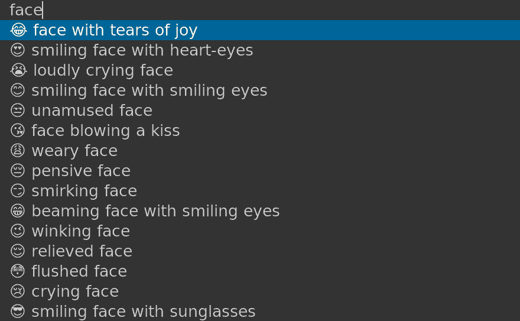

# Emoji Picker

Get a selection of emojis and pick one to copy to clipboard.

- **Author**: Tuncay D.
- **License**: [MIT License](LICENSE)
- **Source**: [Github source](https://github.com/thingsiplay/emojipick)

## Introduction

Are you tired of the preinstalled Emoji tools that comes or does not come with
your distro and you wish to use a different one? Yeah, me neither. Here is it
anyway.



## Usage

At first run a small file from Github will be downloaded, containing the emoji
data. This is needed only once. The script itself will open a small bar on top
of the screen, with a list of smileys and other emojis. Type in something to
filter and narrow down the selection. Use the arrow keys to navigate and
Enter to select.

On selection a notification will appear and the emoji is copied to clipboard.
It is also send to stdout (echo in terminal). There is not much to configure,
just open the script itself and edit them as you like. If you want use `rofi`
instead of `dmenu`, there is a setting to enable it in `emojipick` file. For
that install rofi and enable it by changing the line `use_rofi=0` to
`use_rofi=1` in the file "emojipick". If you are on Wayland, then the menu
defaults to `wofi` instead `dmenu`.

My recommendation is to assign a shortcut to the script `emojipick` and call it
from any place you need. Alternatively you can also use it as a commandline
tool, as it outputs to stdout. However I do not recommend running `dmenu` or
`rofi` directly from terminal in a Wayland session, because they seem to send
key presses (such as arrow keys) to the terminal while you are in the menu. So
in Wayland I recommend installing `wofi` instead.

You can use a favorites file with your emojis, which will be displayed at top
of the dmenu list. The default location is at `~/.myemojis` and should be
formatted like:

```
💩 poop / imagination
👉😎👈 this guy
"very@important.org" email
"Some long text with spaces" sentence with spaces
```

It works with multiple emojis too. In fact, it even works with text until first
space is encountered. If the first character is a quote `"`, then the entire
content until closing quote is considered an emoji. This is useful if it
contain spaces. The location of this file can be changed in the script
`emojipick`.

## Customize command

If the environmental variable `EMOJIPICK_CMD` is set, then it's value is used
to run the menu instead rofi or dmenu. This can be a path or full command with
options. Here some examples:

    $ EMOJIPICK_CMD='rofi -dmenu -l 5' ./emojipick

    $ EMOJIPICK_CMD='dmenu -fn' ./emojipick

Using any alternative program must be compatible with the options of rofi or
dmenu.

## How it works

The entire script is based on 2 parts: one Python program responsible to
download, convert and save the emoji database. The other script is a regular
Bash script, calling the Python program and running menu and other commands.

The emojis and their description are downloaded from
[gist.github.com/oliveratgithub/emojis.json](https://gist.github.com/oliveratgithub/0bf11a9aff0d6da7b46f1490f86a71eb) .

## Installation and Requirements

By default running `emojipick` will lookup and call `emojiget.py` as a command
in the $PATH. But you can configure an alternative path in the script. The
following programs are required depending the configuration and environment.

Required:

- `python3`
- `awk`

Under X11:

- `dmenu` or `rofi` (depending on option `use_rofi`)
- `xclip` (when option `copy_to_clipboard` is enabled)

Under Wayland:

- `wofi` (if option `use_rofi` is disabled, recommended)
- `wl-copy` part of package `wl-clipboard` (when option `copy_to_clipboard` is
  enabled)

Optional:

- `notify-send` part of package `libnotify` (when option `show_notification` is
  enabled)

Default font is set to "Noto Sans", but can be changed. The package name
including this font varies depending on the distribution.

- `noto-fonts` (on Arch)
- `fonts-noto-core` (on Debian)

### Single command to install a setup in one go:

- On Arch/X11 with rofi:

  ```
  sudo pacman -Syu python3 awk rofi xclip libnotify noto-fonts
  ```

- On Arch/Wayland with wofi:

  ```
  sudo pacman -Syu python3 awk wofi wl-clipboard libnotify noto-fonts
  ```

## Additional files in use

Additional to the scripts and required programs the following text files are
in use:

_created automatically_

- `~/.cache/emojiget/emoji.json`
- `~/.cache/emojiget/emoji_filtered.json`

_optional user created data_

- `~/.myemojis`

These are the default paths, if not customized.

## See also

- https://github.com/thingsiplay/emojicherrypick (an alternate)
